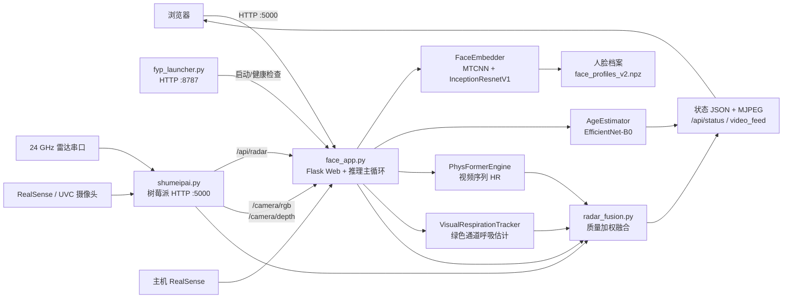

# FYP 多模态人脸与非接触生命体征系统

本文档面向项目开发者，说明当前代码结构、运行时数据流、模块职责、接口和训练入口。

## 1. 项目概览

项目是一个双机部署的研究型演示系统：

- **上位机**运行 Flask Web 应用和深度学习推理，负责摄像头画面、人脸识别、年龄段估计、视觉生命体征和多传感器融合。
- **树莓派**运行雷达与摄像头采集服务，负责毫米波雷达串口读取、雷达信号处理以及可选的 RealSense/UVC 摄像头 MJPEG 输出。
- **浏览器**只访问上位机 `face_app.py` 提供的统一界面。
- `fyp_launcher.py` 是上位机启动器，负责启动、检测和回收 `face_app.py`，也可由树莓派通过 HTTP 请求唤醒。

系统不是医疗设备，输出结果用于课程项目和算法验证。

## 2. 系统架构与数据流



### 2.1 上位机每帧处理流程

`face_app.py` 的采集/处理线程大致按以下顺序运行：

1. 从本机 RealSense 获取 RGB/深度帧，或从树莓派读取 `/camera/rgb` 和 `/camera/depth`。
2. 使用 `FaceEmbedder` 检测所有人脸，并为每张人脸生成归一化 embedding、检测置信度、清晰度和 bounding box。
3. 对每个有效人脸计算深度中值、深度有效比例和距离区间。
4. 将人脸 ROI 送入 `PhysFormerEngine`。每个跟踪目标需要累计 160 帧，之后使用滑动窗口估计心率。
5. 将人脸 ROI 的绿色通道送入 `VisualRespirationTracker`，约累计 150 帧后估计视觉呼吸率。
6. 对有效人脸执行年龄段分类，并应用校准、滑动窗口平滑；录入时可用真实年龄进行评估或年龄段搜索。
7. 在识别模式下，将 embedding 与已保存的人脸模板做余弦相似度比较，并通过时间窗口多数投票稳定结果。
8. 后台线程约每 0.45 秒从树莓派轮询 `/api/radar`，缓存雷达各通道的心率、呼吸率和质量。
9. `radar_fusion.py` 按深度排序或深度区间将人脸与雷达 bin 配对，再按视觉/雷达质量加权得到融合结果。
10. 前端轮询 `/api/status`，同时通过 MJPEG `/video_feed` 和 `/video_depth` 显示视频。

### 2.2 雷达数据流

1. `shumeipai.py` 从 `FYP_SERIAL` 指定的串口读取雷达帧，默认波特率为 `921600`。
2. 每帧包含 256 字节数据；程序将其转换为相位并进行 unwrap。
3. 雷达使用胸部区域和 5 个 range-bin 通道分别维护历史窗口。
4. 对呼吸频段 `0.1-0.5 Hz` 和心率频段 `1.0-2.5 Hz` 做滤波、FFT/自相关频率估计、质量评估和 EMA 平滑。
5. `/api/radar` 返回当前整体指标、最近信号和 `radar_channels`，供上位机融合。

## 3. 生命体征模型与实现

当前代码没有名为 `RCG` 的独立模型。项目中的相关实现是 **视觉 rPPG** 和 **雷达生命体征估计**；如果“RCG”指的是通过视频恢复生理信号，代码中的对应术语是 `rPPG`，实现位于 `physformer_engine.py` 和 `physformer/PhysFormer/`。

### 3.1 视觉心率：PhysFormer / rPPG

视觉心率不是直接对单张人脸图片分类，而是从连续人脸视频中恢复一维的远程光电容积脉搏波（remote PPG，简称 rPPG），再从 rPPG 的频谱峰值换算心率。

#### 在线推理流程

1. `face_app.py` 每帧用 `FaceEmbedder` 检测人脸，得到人脸框；检测器使用 MTCNN，embedding 模型使用 InceptionResnetV1。这里的人脸框同时作为生理信号 ROI。
2. `PhysFormerEngine` 用 IoU 将当前人脸框与已有 track 匹配，为每个目标维护独立的帧缓存。
3. 每张人脸 ROI 被裁剪并缩放为 `128 x 128`，连续缓存 `160` 帧。默认视频帧率为 `30 FPS`，因此首个心率结果需要约 `5.3 秒` 的视频。
4. 160 帧组成张量 `[B, C, T, H, W] = [1, 3, 160, 128, 128]`，输入 PhysFormer。
5. 模型输出长度为 160 的 rPPG 序列。推理端先做零均值和标准差归一化，再对 `0.65-3.5 Hz` 的频率范围寻找最大频谱峰。
6. 峰值频率乘以 60 转换为 BPM，并限制在 `40-200 BPM`。同一个 track 的最近 5 次结果再取中位数，减少瞬时跳变。
7. 当缓存达到 160 帧后，移除最多 80 帧，保留剩余帧继续滑动推理，因此不是每帧都重新构建完整历史。

#### PhysFormer 网络结构

模型定义在 `physformer/PhysFormer/model/Physformer.py`，运行时由 `physformer_engine.py` 加载：

- 前端是 3D 卷积 stem，联合提取空间和时间特征，并在空间维度逐步下采样。
- 中间使用时空 Transformer，共 12 层，分成 3 个 Transformer stage，每层使用 temporal center-difference 相关结构增强时间变化建模。
- 输入经过 `4 x 4 x 4` 的时空 patch embedding，形成时空 token。
- 后端通过时间维度上采样和 `Conv1d` 投影，将特征还原成 160 点的一维 rPPG 序列。
- 推理调用模型返回 `rPPG, Score1, Score2, Score3`；当前 Web 应用只使用 rPPG 计算心率，三个 attention/score 输出不参与页面指标。

#### PhysFormer 训练

训练脚本使用视频帧和同步生理信号监督 rPPG：

- UBFC-rPPG：`train_Physformer_160_UBFC.py` 从 `vid.avi` 和 `ground_truth.txt` 构建 160 帧片段。
- VIPL-HR：`train_Physformer_160_VIPL.py` 使用 VIPL 的视频和 ECG/HR 标注。
- rPPG 波形使用负 Pearson 相关损失；同时结合频域分布/峰值相关损失，使输出波形和心率频率都接近标注。
- 训练完成后生成 `.pkl`，在线端默认按 `weights/Physformer_UBFC_best.pkl` 等候选路径加载。

### 3.2 视觉呼吸：绿色通道频谱估计

视觉呼吸率不是由 PhysFormer 直接输出，而是由 `visual_respiration.py` 的 `VisualRespirationTracker` 作为轻量辅助分支估计。

1. 对每个 PhysFormer `track_id`，截取同一个人脸框 ROI。
2. 取 ROI 的 BGR 绿色通道，并计算所有像素的平均值，形成随时间变化的一维光强序列。
3. 每个 track 保存最多约 300 个采样点；至少累计 `150` 帧后，取最近 150 点进行估计，即约 `5 秒 @ 30 FPS`。
4. 去均值后执行 FFT，只保留 `0.12-0.55 Hz`，对应约 `7.2-33 BPM` 的呼吸频率搜索区间。
5. 取频谱峰值并将 Hz 转成 BPM，再裁剪到 `6-45 BPM`。
6. 使用 `alpha=0.32` 的 EMA 对同一 track 的呼吸率平滑；当信号不足或方差接近 0 时，沿用上一次有效值。

该分支计算成本低，但容易受到光照变化、面部动作和 ROI 框变化影响，因此在 `radar_fusion.py` 中作为辅助呼吸来源，而不是唯一结果。

### 3.3 雷达呼吸和心率：24 GHz 相位信号处理

树莓派端的雷达实现位于 `shumeipai.py` 的 `BreathingHeartSystem`。它不是神经网络，而是基于雷达相位序列的信号处理链路。

#### 原始数据和通道

- 串口默认波特率 `921600`，每个有效雷达帧包含 `256` 字节。
- 字节值映射到相位：`phase = byte * 2π / 255`，然后执行相位展开 `unwrap`。
- 整体生命体征主通道使用相位索引 `[100:156]` 的胸部区域均值。
- 为支持多人场景，另外将 256 个 range bin 划分为 5 个通道：`0-51`、`51-102`、`102-153`、`153-204`、`204-256`。
- 每个通道以 `50 Hz` 采样，并至少积累 15 秒历史后才开始稳定估计。

#### 频率估计流程

对呼吸和心跳分别执行以下步骤：

1. 对相位信号去均值，并限制极端离群值。
2. 呼吸支路使用 Butterworth 带通 `0.1-0.5 Hz`，心率支路使用 Butterworth 带通 `1.0-2.5 Hz`。
3. 心率支路先使用陷波抑制部分低频谐波；当呼吸率足够稳定时，还会针对呼吸频率的高次谐波自适应增加陷波。
4. 使用加窗 FFT 找到频谱峰值，同时使用自相关方法估计周期。
5. 当 FFT 和自相关结果接近时加权融合；两者分歧较大时降低较不可靠一侧的权重。
6. 呼吸率和心率经过最近 7 次结果的中位数窗口，再经过 `alpha=0.22` 的 EMA 和最大跳变限制。
7. 雷达心率只接受 `40-180 BPM` 的结果；若心率接近呼吸率的 4 倍且可能是谐波误检，则置为无效。

每个雷达结果还计算信号质量：信号标准差与一阶差分噪声的比值转换为 `0-1` 质量分数。`/api/radar` 会返回整体通道和 5 个 `radar_channels` 的 HR、呼吸率、质量以及最近波形。

### 3.4 视觉与雷达融合

`radar_fusion.py` 不直接重新处理原始信号，而是融合三类已经计算好的结果：

- PhysFormer 的视觉心率 `visual_hr_bpm`；
- 绿色通道的视觉呼吸率 `visual_resp_bpm`；
- 雷达通道的 `radar_hr_bpm` 和 `radar_resp_bpm`。

多人场景下，先按人脸深度排序，再根据深度场景范围（默认 `0.35-2.3 m`）将人脸与雷达 bin 贪心匹配。若深度不可用，则退化为排序配对。

融合权重具有以下特点：

- 视觉心率权重随 PhysFormer 缓冲进度增长，从约 `0.18` 逐步增加到约 `1.0`。
- 雷达心率权重取雷达心率质量，默认下限权重为 `0.38`。
- 视觉呼吸率使用固定权重 `0.42`，雷达呼吸率使用雷达呼吸质量，默认权重为 `0.45`。
- 两个来源相对差异超过阈值时，较低权重一侧会被进一步衰减，避免明显冲突的结果简单平均。
- 只有通过合理范围检查的数值才参与融合；如果只有一个来源有效，则直接使用该来源。

最终每个人的结果会包含原始视觉/雷达值、深度、雷达 bin、质量、融合值以及融合方法，例如 `fused_hr_bpm`、`fused_resp_bpm`、`fusion_hr_method` 和 `fusion_rr_method`。

### 3.5 RCG-ECG Loop 分析

`loop/rcg_ecg_analysis.py` 将两个 notebook 中的双向测试逻辑整理为可被 Web 调用的 Python 模块。两个方向都使用条件 1-D U-Net 扩散模型：一个以 RCG 为条件生成 ECG，另一个以 ECG 为条件生成 RCG。

- 每个 CSV 文件必须包含 `ECG` 和 `RCG` 或 `RCG_ch1` 两列；两列长度必须一致。
- 数据按长度 `640`、步长 `30` 的滑动窗口切分，与 notebook 训练/测试设置一致。
- 模型配置默认是 `T=100`、`beta_start=1e-4`、`beta_end=0.02`、`base_channels=64`、`time_emb_dim=128`。
- 网络由时间步正弦嵌入、残差卷积块、SE 通道注意力、瓶颈自注意力和 1-D U-Net 跳跃连接组成。
- Web API `POST /api/rcg-ecg/analyse` 接收数据集 CSV 文件，最多分析 8 个窗口，返回 `RCG → ECG` 和 `ECG → RCG` 两个预测波形。
- 页面使用 `ECG → RCG` 预测结果与原始 RCG 进行 Pearson 相似度、MSE 和 MAE 对比；第二张图不是 ECG reference。
- 页面中的 `Load data` 用于选择数据集目录，`Analyse` 才会执行 PyTorch 推理；当前接口不保存上传数据。
- notebook 训练生成的 `last_model.pt` 或 `best_model.pt` 不在当前仓库中。部署前设置 `RCG_ECG_CHECKPOINT` 指向 checkpoint，例如：

```powershell
$env:RCG_ECG_CHECKPOINT = "D:\models\our-9-27-raw\last_model.pt"
$env:ECG_RCG_CHECKPOINT = "D:\models\unet-9-27\last_model.pt"
python fyp_launcher.py
```

## 4. 文件与目录说明

### 4.1 运行时入口和核心模块

| 文件 | 职责 |
|---|---|
| `face_app.py` | 上位机主应用；初始化模型、采集视频、执行人脸/年龄/生命体征推理、提供 Web 页面和 API。 |
| `fyp_launcher.py` | 上位机生命周期管理；监听 `8787`，启动 `face_app.py`，检查 `5000`，清理残留进程。 |
| `shumeipai.py` | 树莓派边缘服务；读取雷达串口，处理雷达生命体征，提供摄像头 MJPEG 和雷达 JSON API。 |
| `config.py` | 集中保存分辨率、阈值、模型路径、网络地址及环境变量配置。 |
| `face_identity.py` | MTCNN 人脸检测和 InceptionResnetV1 embedding；同时计算 Laplacian 清晰度。 |
| `age_estimator.py` | 加载 EfficientNet-B0 年龄段模型，对人脸 crop 输出类别和置信度。 |
| `age_band_search.py` | 将真实年龄映射到年龄段，在录入评估时执行相邻年龄段搜索。 |
| `physformer_engine.py` | 封装 PhysFormer；按 IoU 跟踪人脸，缓存 160 帧，输出每个目标的视觉心率。 |
| `visual_respiration.py` | 对每个 PhysFormer track 保存 ROI 绿色通道序列，估计视觉呼吸率。 |
| `radar_fusion.py` | 将人脸、深度和雷达通道配对，按质量和分歧程度加权融合 HR/呼吸率。 |
| `realsense_utils.py` | 深度尺度、中值距离、有效像素比例和距离区间工具函数。 |

### 4.2 Web 前端

| 路径 | 职责 |
|---|---|
| `templates/index.html` | 主监控界面，包含录入、识别、深度、人脸、年龄、视觉生命体征、雷达和融合视图。 |
| `templates/docs.html` | README 项目说明页面模板。 |
| `static/css/fyp.css` | 页面样式、浅色/深色主题、布局和图表容器样式。 |
| `README.md` | 面向部署和使用者的英文说明；Web 的 `/readme` 页面会读取它并渲染。 |

前端主要通过 `fetch` 请求 `/api/status` 及控制 API，RGB/深度视频使用 multipart MJPEG 流，不经过 JSON 编码。

### 4.3 模型、档案和数据

| 路径 | 用途 |
|---|---|
| `age_model_effnet_b0.pth` | 年龄段 EfficientNet-B0 权重，默认分为儿童、青少年、青年、中年、老年五类。 |
| `face_profiles_v2.npz` | 已录入的人脸模板 embedding。运行时由 `face_app.py` 加载和更新。 |
| `face_profile_meta.json` | 人脸槽位显示名及相关元数据。 |
| `weights/` | PhysFormer 推理权重目录；运行时优先寻找 `Physformer_UBFC_best.pkl`，再使用其他候选权重。 |
| `yolov8n.pt` | YOLO 权重文件；当前主运行链路的人脸识别不依赖它，相关配置仍保留。 |
| `UTKFace/` | 年龄模型训练数据目录。 |
| `utkface_aligned_cropped/` | 对齐后的 UTKFace 数据目录。 |
| `crop_part1/` | 数据集或预处理图片目录，具体用途取决于实验脚本。 |
| `loop/` | RCG-ECG notebook、`rcg_ecg_analysis.py` 推理模块和相关实验代码。 |

### 4.4 PhysFormer 子项目

`physformer/PhysFormer/` 保留了 PhysFormer 原始实现、数据加载器和训练/推理脚本：

- `model/Physformer.py`、`model/transformer_layer.py`：模型结构。
- `Loadtemporal_data*.py`：VIPL、UBFC 和通用时序数据加载。
- `train_Physformer_160_UBFC.py`：使用 UBFC-rPPG 训练/微调。
- `train_Physformer_160_VIPL.py`：使用 VIPL 数据训练。
- `inference_OneSample_VIPL_PhysFormer.py`：VIPL 单样本推理/评估。
- `TorchLossComputer.py`：训练损失和频域相关工具。
- `run_train_ubfc.ps1`、`run_train_vipl.ps1`：项目根目录下的 Windows 训练包装脚本。
- `Physformer_UBFC_*`、`Inference_*`：训练日志、checkpoint、`.mat` 结果等实验产物。

## 5. Web API

### 5.1 上位机 `face_app.py`：默认端口 5000

| 方法 | 路径 | 说明 |
|---|---|---|
| `GET` | `/` | 主 Web 界面。 |
| `GET` | `/readme` | 将 `README.md` 渲染为文档页。 |
| `GET` | `/video_feed` | RGB/处理后视频 MJPEG 流。 |
| `GET` | `/video_depth` | 深度可视化 MJPEG 流。 |
| `GET` | `/api/status` | 当前模式、档案、识别、年龄、生命体征、融合和传感器状态。 |
| `POST` | `/api/enroll/start` | 开始指定 `person1` 到 `person10` 的人脸录入，可带 `display_name`、`actual_age`。 |
| `POST` | `/api/recognize/start` | 开始识别，要求至少有一个已录入档案。 |
| `POST` | `/api/profile/delete` | 删除指定人脸槽位及其元数据。 |
| `POST` | `/api/profile/display_name` | 更新档案显示名。 |
| `POST` | `/api/stop` | 回到 idle 状态，清空识别稳定状态。 |
| `GET` | `/api/radar/poll` | 代理读取树莓派 `/api/radar`。 |
| `POST` | `/api/radar/start` | 代理启动树莓派雷达。 |
| `POST` | `/api/radar/stop` | 代理停止树莓派雷达。 |
| `POST` | `/api/rcg-ecg/analyse` | 接收 notebook 格式的 RCG/ECG CSV 数据集并执行条件扩散推理。 |

### 5.2 树莓派 `shumeipai.py`：默认端口 5000

| 方法 | 路径 | 说明 |
|---|---|---|
| `GET` | `/` | 树莓派采集端提示页。 |
| `GET` | `/api/radar` | 返回雷达当前状态、整体 HR/呼吸率、质量、波形和多 bin 结果。 |
| `POST` | `/api/start-radar` | 打开串口并启动雷达读取线程。 |
| `POST` | `/api/stop-radar` | 停止读取、清理历史缓存并关闭串口。 |
| `GET` | `/camera/rgb` | 摄像头 RGB MJPEG 流。 |
| `GET` | `/camera/depth` | RealSense 深度可视化 MJPEG 流；无深度时返回占位图。 |

### 5.3 启动器 `fyp_launcher.py`：默认端口 8787

| 方法 | 路径 | 说明 |
|---|---|---|
| `GET` | `/` | 重定向到上位机 Web 页面。 |
| `GET` | `/health` | 返回 launcher 存活状态和 face_app 是否运行。 |
| `POST` | `/launch` | 启动 face_app；配置 `FYP_LAUNCHER_TOKEN` 后需要 `X-FYP-Token` 请求头。 |

## 6. 运行方式

### 6.1 主机端

推荐使用已有的 `fyp` Conda 环境，并安装 PyTorch、TorchVision、OpenCV、Flask、NumPy、SciPy、`facenet-pytorch`、`pyrealsense2` 等依赖。PhysFormer 可使用 CUDA，也可在 CPU 上加载，但实时性能会明显下降。

```powershell
cd F:\py\FYP-main
conda activate fyp
$env:RADAR_PI_BASE = "http://<树莓派IP>:5000"
$env:USE_PI_CAMERA = "1"
python fyp_launcher.py
```

然后访问 `http://127.0.0.1:5000`。若只调试主应用，也可以直接运行：

```powershell
python face_app.py
```

当 `USE_PI_CAMERA=0` 时，`face_app.py` 尝试使用主机本地 Intel RealSense；雷达仍可通过 `RADAR_PI_BASE` 从树莓派获取。

### 6.2 树莓派端

```bash
cd /path/to/FYP-main
export FYP_SERIAL=/dev/ttyUSB0
export FYP_PC_HOST=<主机IP>
export FYP_UI_URL=http://<主机IP>:5000
export FYP_LAUNCHER_URL=http://<主机IP>:8787
python3 shumeipai.py
```

树莓派服务默认监听 `0.0.0.0:5000`。`FYP_AUTO_START=1` 时会尝试调用主机 `/launch`，随后等待主机 Web 就绪并打开 Chromium kiosk。

## 7. 重要配置

所有默认值集中在 `config.py`，网络和树莓派摄像头选项还由环境变量控制。

| 变量 | 默认值 | 作用 |
|---|---:|---|
| `RADAR_PI_BASE` | `http://10.200.179.43:5000` | 上位机访问树莓派雷达/摄像头服务的基地址。 |
| `USE_PI_CAMERA` | `1` | `1` 使用树莓派视频，`0` 使用主机 RealSense。 |
| `PHYSFORMER_ENABLED` | `1` | 是否启用 PhysFormer。设为 `0` 可在无权重或调试时关闭。 |
| `PHYSFORMER_WEIGHTS` | 空 | 显式指定 PhysFormer `.pkl` 路径。 |
| `FUSION_USE_DEPTH_BIN_MATCH` | `1` | 是否按深度区间贪心匹配人脸和雷达 bin。 |
| `FUSION_DEPTH_SCENE_MIN_M` | `0.35` | 融合场景近端距离。 |
| `FUSION_DEPTH_SCENE_MAX_M` | `2.3` | 融合场景远端距离。 |
| `FYP_LAUNCHER_PORT` | `8787` | 启动器监听端口。 |
| `FYP_FACEAPP_CHECK` | `http://127.0.0.1:5000/api/status` | 启动器健康检查地址。 |
| `FYP_LAUNCHER_TOKEN` | 空 | launcher 和树莓派之间的可选共享令牌。 |
| `FYP_SERIAL` | `/dev/ttyUSB0` | 树莓派雷达串口。 |
| `FYP_CAMERA_MODE` | `auto` | 树莓派摄像头模式：`auto`、`realsense` 或 `uvc`。 |
| `FYP_CAMERA_ENABLE` | `1` | 是否启动树莓派摄像头采集线程。 |

## 8. 状态与持久化

- 应用启动时，`face_app.py` 加载 `face_profiles_v2.npz` 和 `face_profile_meta.json`。
- 人脸录入完成后，embedding 模板写回 `.npz`，显示名写回 `.json`。
- 人脸最多保存 10 个槽位：`person1` 到 `person10`。
- 运行时状态（当前模式、视频帧、识别结果、雷达缓存、融合结果）保存在进程内存，不会自动写入数据库。
- `fyp_launcher.py` 将由它启动的 `face_app.py` 输出追加到根目录 `.face_app_boot.log`。

## 9. 年龄模型训练

`train_age_model.py` 使用 UTKFace 文件名中的年龄，或 FairFace CSV 中的年龄区间，将数据映射到 `config.py` 的五个年龄段。训练模型仍为 EfficientNet-B0，输出默认写入 `age_model_effnet_b0.pth`。

示例：

```powershell
python train_age_model.py --utkface-root .\UTKFace --epochs 12 --device auto
```

训练脚本包含类别加权采样、验证集、准确率、相邻年龄段准确率、macro recall 和混淆矩阵统计。

## 10. PhysFormer 训练与推理

生产运行只使用 `physformer_engine.py` 的推理封装，不会在 Web 请求中执行训练。训练时：

- UBFC-rPPG：准备包含 `subject*/vid.avi` 和 `ground_truth.txt` 的数据目录，使用 `physformer/PhysFormer/train_Physformer_160_UBFC.py`。
- VIPL-HR：按原 PhysFormer 数据布局准备数据，使用 `train_Physformer_160_VIPL.py`。
- 训练生成的 `.pkl` 放入 `weights/` 或通过 `PHYSFORMER_WEIGHTS` 指定。

推理封装的默认候选顺序是：

1. `weights/Physformer_UBFC_best.pkl`
2. `physformer/PhysFormer/Physformer_UBFC_finetune/Physformer_UBFC_1_8.pkl`
3. `weights/Physformer_VIPL_fold1.pkl`

## 11. 开发注意事项

- `face_app.py` 的模型采用延迟初始化，并在启动时通过后台线程预加载；首次运行 `facenet-pytorch` 可能下载 InceptionResnetV1 权重。
- 视觉心率需要 160 帧窗口，视觉呼吸需要约 150 帧窗口，因此启动后短时间内没有结果是正常现象。
- 树莓派 `/camera/depth` 输出的是深度可视化 JPEG，不是原始深度矩阵；当前上位机在使用 Pi 摄像头时不能像本机 RealSense 一样直接从原始深度图计算每个 ROI 的深度。
- 多人融合依赖人脸深度排序/距离区间与雷达 bin 的对应关系；人员移动、遮挡或深度不可用时，融合结果可能退化为单传感器结果。
- 人脸录入应保证画面中只有一个人，并保持清晰、正面和稳定距离；模糊、检测置信度不足或深度质量不合格的样本不会作为高质量样本使用。
- 修改模型输入尺寸、年龄类别、PhysFormer 窗口或网络端口时，应同步检查 `config.py`、前端字段和持久化文件兼容性。

## 12. 典型故障排查

| 现象 | 优先检查 |
|---|---|
| 浏览器无法打开 | 检查 `face_app.py` 是否监听 5000，查看 `.face_app_boot.log`，确认端口未被其他进程占用。 |
| 上位机没有雷达数据 | 检查树莓派 IP、`RADAR_PI_BASE`、树莓派 `/api/radar` 和 `FYP_SERIAL`。 |
| 没有 RGB 视频 | 检查 `USE_PI_CAMERA`、树莓派 `/camera/rgb`、RealSense USB 连接和 `FYP_CAMERA_MODE`。 |
| PhysFormer 未输出心率 | 检查权重路径、PyTorch/模型导入错误，并等待 160 帧缓冲完成。 |
| 年龄模型不可用 | 检查 `age_model_effnet_b0.pth` 是否存在以及 TorchVision 模型结构是否匹配。 |
| 多人融合对应错误 | 检查深度有效性、`FUSION_DEPTH_SCENE_*` 范围和雷达 bin 的实际空间对应关系。 |

